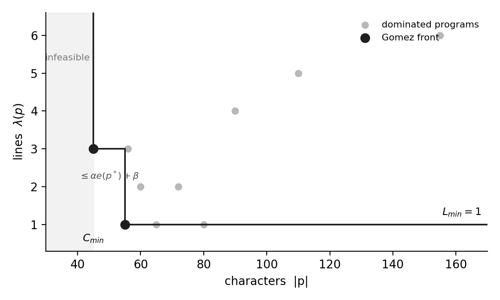

</img>

## Gomez Character–Line Minimization Theorem

How short can a program be? This repository holds the paper that asks, for any function or class `f` in a language `L`, whether there is a theoretical minimum number of characters and lines needed to write it, and whether we can ever know what it is.

The answer: the minima exist, the trade-off between them is a finite staircase (the <b>Gomez front</b>), the character minimum is sandwiched between two Kolmogorov bounds, it is uncomputable, and in Python one line is always enough at a cost of exactly `8 + (newlines) + (escaped characters)`.

📄 <b>Paper:</b> [The Gomez Character–Line Minimization Theorem: Existence, Bounds, and Uncomputability of Minimal Program Representations](./paper.pdf)

## The Theorem

Let `L` be a Turing-complete language over a finite alphabet `Σ` (with `\n ∈ Σ`) and let `f` be implementable in `L`. Define

```
C_min(f, L) = min { |p|              : E_L(p) ≅ f }    # fewest characters
L_min(f, L) = min { 1 + count(p, \n) : E_L(p) ≅ f }    # fewest lines
```

and the <b>Gomez Minimum Program Representation</b> `GMPR(f, L)` as the Pareto set of programs that minimize both at once. Then:

<b>(i) Existence and finiteness.</b> Both minima exist and are attained. The Gomez front is a non-empty finite staircase with at most `ℓ₁ − L_min + 1` points, where `ℓ₁` is the line count of the shortest program.

<b>(ii) Kolmogorov sandwich.</b> For every universal machine `U` there are language constants `c_L, d_L` such that

```
⌈ (K_U(f) − c_L) / log₂|Σ| ⌉  ≤  C_min(f, L)  ≤  ⌈ (K_U(f) + 1) / log₂ B_L ⌉ + d_L
```

where `B_L` is the radix of `L`'s literals (93 for Python strings). So `C_min = Θ(K_U(f))`.

<b>(iii) Uncomputability and immunity.</b> No algorithm computes `p ↦ C_min(E_L(p), L)`. The set of character-minimal programs is immune: infinite, but with no infinite computably enumerable subset. This is a Berry-paradox argument in the spirit of Blum (1967).

<b>(iv) Line collapse.</b> If `L` is line-collapsible with cost `(α, β)`, then `L_min = 1` and

```
C_min  ≤  C[1]  ≤  C_min + α·e(p*) + β
```

where `C[1]` is the one-line minimum and `e(p*)` counts escape-relevant characters in a character-minimal `p*`. CPython is line-collapsible with `(α, β) = (1, 8)`. Brainfuck has `(0, 0)`, so one program wins both objectives. Whitespace is not collapsible at all.

## Usage

The line-collapse map `τ` from Lemma 1. It turns any module-level CPython program into a newline-free equivalent, and the paper shows its cost formula held with equality on all 48 multi-line programs tested.

```python
def tau(p):
    """Newline-free equivalent of a module-level CPython program (Lemma 1)."""
    if "\n" not in p:
        return p
    q = '"' if p.count('"') <= p.count("'") else "'"
    body = p.replace("\\", "\\\\").replace(q, "\\" + q).replace("\n", "\\n")
    return "exec(" + q + body + q + ")"
```

```python
src = 'def f(s):\n try:return int(s)\n except:return 0'   # 45 chars, 3 lines

one_line = tau(src)
# exec("def f(s):\n try:return int(s)\n except:return 0")  # 55 chars, 1 line

assert len(one_line) == len(src) + 8 + src.count("\n") + src.count("\\") + src.count('"')
```

A worked example from the paper. Euclid's gcd goes from canonical, to the output of the automatic reducer, to the best known program. Note that `from math import gcd as f` is shorter but <i>not</i> equivalent, since the reference returns `f(4, -6) = -2` and `math.gcd` returns `2`.

```python
def f(a, b):                       # canonical: 124 chars, 5 lines
    """Greatest common divisor by Euclid's algorithm."""
    while b != 0:
        a, b = b, a % b
    return a

def f(a,b):                        # GomezReduce output: 40 chars, 3 lines
 while b:a,b=b,a%b
 return a

f=lambda a,b:b and f(b,a%b)or a    # best known: 31 chars, 1 line
```

And a class. A stack with interface `{push, pop, peek, size, empty}` drops from 347 characters over 20 lines to one line of 89, by inheriting `pop` and `__len__` from `list`. Even the exception messages on an empty stack are unchanged.

```python
class S(list):push=list.append;peek=lambda s:s[-1];size=list.__len__;empty=lambda s:s==[]
```

## Algorithms

The theorem rules out computing `C_min` in general. The paper gives three practical routes.

- <b>ExactFront</b> — enumerate `Σ*` by increasing length and keep every non-dominated hit. Exact, for fragments where equivalence is decidable.
- <b>SemanticDP</b> — dynamic programming over <i>meanings</i> rather than strings, keeping one witness per behavior. This is what produced the exact results below.
- <b>GomezReduce</b> — a reducer for real Python. Phase 1 applies transformations that are provably safe by construction (alpha-renaming, docstring stripping, AST-invariant whitespace and line joins). Phase 2 runs delta debugging and substring deletion under a differential-testing oracle. Its output is an upper bound on `C_min`, certified only as far as the oracle is.

## Results

<b>Exact minima.</b> In a small polynomial language with `|Σ| = 8`, SemanticDP computed the exact `C_min` of all 1,942,453 behaviors expressible in at most 14 characters, in 18 seconds. At length 14 there are 198,527,152 valid programs but only 1,598,072 distinct meanings. Minima are not what you'd guess: `x² + 2x + 1` is minimal as `1+x*(x+2)`, two characters shorter than `(x+1)*(x+1)`.

<b>Python benchmark.</b> Twelve tasks, ten functions and two classes, as characters / lines. Best columns are the shortest verified programs known; true minima are uncomputable.

| Task | Canonical | GomezReduce | Best ≥2-line | Best 1-line | Best-known front |
|---|---|---|---|---|---|
| factorial | 150 / 6 | 53 / 4 | 50 / 4 | 28 / 1 | (28,1) |
| fibonacci | 148 / 6 | 57 / 4 | 57 / 4 | 41 / 1 | (41,1) |
| gcd | 124 / 5 | 40 / 3 | 40 / 3 | 31 / 1 | (31,1) |
| is_prime | 201 / 10 | 95 / 7 | 72 / 6 | 47 / 1 | (47,1) |
| palindrome | 211 / 9 | 91 / 6 | 28 / 2 | 21 / 1 | (21,1) |
| fizzbuzz | 353 / 13 | 169 / 8 | 74 / 2 | 68 / 1 | (68,1) |
| flatten | 214 / 9 | 96 / 6 | 62 / 4 | 57 / 1 | (57,1) |
| collatz | 228 / 10 | 77 / 7 † | 61 / 4 | 45 / 1 | (45,1) |
| transpose | 207 / 6 | 102 / 3 | 37 / 2 | 31 / 1 | (31,1) |
| safe_int | 155 / 6 | 56 / 3 | 45 / 3 | 55 / 1 | (45,3), (55,1) |
| stack (class) | 347 / 20 | 204 / 7 | 204 / 7 | 89 / 1 | (89,1) |
| account (class) | 406 / 15 | 197 / 6 | 188 / 6 | 194 / 1 | (188,6), (194,1) |
| <b>Total</b> | <b>2,744</b> | <b>1,237</b> | | | <b>691</b> |

† equivalent only on the test domain: Phase 2 swapped `n//2` for `n/2`, which agrees up to `2⁵³` and then diverges. Testing can overfit.

Takeaways:

- The provably safe Phase 1 alone removes 54.8% of canonical characters. Phase 2 adds 0.1 points over 12,097 oracle calls.
- Best-known programs are 74.8% shorter than canonical code, and get there by semantic rewrites (recursion, comprehensions, inheritance, library reuse) that character deletion can never find. That is the practical face of uncomputability.
- In 10 of 12 tasks the shortest known program is already one line. The two exceptions need `try/except` or `raise`, which Python has no expression form for, so their fronts have two points.
- Minimal programs are nearly incompressible, as Corollary 2 predicts: order-0 entropy rose from 4.28 to 5.06 bits per character from canonical to best-known.

## Experiments

The scripts behind §6 of the paper live in [`experiments/`](./experiments). Everything ran on CPython 3.13 with warnings promoted to errors.

```bash
# Experiment 1: exact C_min for every polynomial in the 8-symbol fragment (Algorithm 2, SemanticDP)
python3 experiments/exp1_poly.py

# Experiment 1b: exact character complexity of the integers 0..400
python3 experiments/exp1b_const.py

# Experiment 2: differential-testing oracle, GomezReduce, and line collapse on the 12 Python tasks
cd experiments && python3 harness.py   # writes exp2.json
```

Tasks, interfaces, domains, and candidate programs are specified in [`experiments/tasks.py`](./experiments/tasks.py). A candidate is only accepted if the oracle in [`experiments/harness.py`](./experiments/harness.py) finds it observationally equivalent to the reference on the domain.

## Todo

- [x] existence, finiteness, and the staircase bound on the Gomez front
- [x] two-sided Kolmogorov bound on `C_min`
- [x] uncomputability and immunity of the character-minimal set
- [x] line-collapse law with exact CPython constants
- [x] exact minima for 1.94M polynomial behaviors
- [x] 12-task Python benchmark with a certified-by-testing reducer
- [ ] time-bounded variant of `C_min` in the style of Levin's `Kt`
- [ ] tighter language constants `c_L, d_L` for production languages
- [ ] fronts for languages where `L_min > 1` (Whitespace, C with preprocessor directives)

## Citations

```bibtex
@article{gomez2026characterline,
    title   = {The Gomez Character--Line Minimization Theorem: Existence, Bounds, and Uncomputability of Minimal Program Representations},
    author  = {Kye Gomez},
    year    = {2026},
    url     = {https://github.com/kyegomez/Gomez-Minimization-Paper}
}
```

```bibtex
@article{blum1967size,
    title   = {On the size of machines},
    author  = {Manuel Blum},
    journal = {Information and Control},
    volume  = {11},
    number  = {3},
    pages   = {257--265},
    year    = {1967}
}
```

```bibtex
@article{kolmogorov1965three,
    title   = {Three approaches to the quantitative definition of information},
    author  = {Andrey N. Kolmogorov},
    journal = {Problems of Information Transmission},
    volume  = {1},
    number  = {1},
    pages   = {1--7},
    year    = {1965}
}
```

```bibtex
@article{zeller2002simplifying,
    title   = {Simplifying and isolating failure-inducing input},
    author  = {Andreas Zeller and Ralf Hildebrandt},
    journal = {IEEE Transactions on Software Engineering},
    volume  = {28},
    number  = {2},
    pages   = {183--200},
    year    = {2002}
}
```

*Perfection is achieved, not when there is nothing more to add, but when there is nothing left to take away.* — Antoine de Saint-Exupéry
